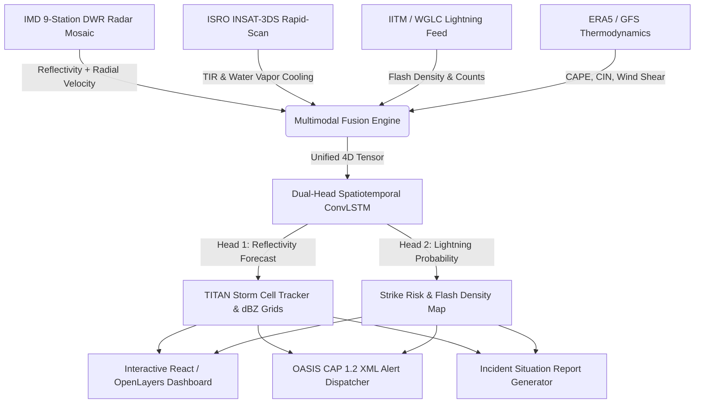

<div align="center">
  
  
  
  
  
  <br/><br/>
  
  <h1>🌩️ STORMTRACE</h1>
  <h3>AI/ML Multimodal Nowcasting of Thunderstorm and Lightning Using Multi-Radar, Satellite, Lightning & Model Data</h3>
  <p><b>Team Targaryen</b> | Smart India Hackathon 2026</p>

  <p align="center">
    <i>An operational-grade AI meteorology platform engineered for the 0–2h convective hazard gap to protect lives, aviation, and the power grid.</i>
  </p>
</div>

---

## 🏆 1. Problem Statement & Impact (MoES / IMD #26072)

**Problem Statement Title**: *AIML based Nowcasting of thunderstorm and lightning using atmospheric observation including multiple radars, satellite, lightning and model data.*  
**Organization**: Ministry of Earth Sciences (MoES) | **Department**: India Meteorological Department (IMD) | **Theme**: Disaster Management

### The 0–2 Hour Meteorological Gap
Severe convective thunderstorms, squall lines, and cloud-to-ground (CG) lightning cause over 2,500 fatalities annually in India. Traditional Numerical Weather Prediction (NWP) models (like GFS/WRF) require 3–6 hours of compute latency and have coarse spatial resolutions (>3 km) that cannot resolve rapidly evolving convective cells. Doppler Weather Radars have beam blockage and cone-of-silence gaps, while geostationary satellites suffer from parallax and parallax-lag.

### The STORMTRACE Solution
**STORMTRACE** fuses 4 complementary atmospheric observation streams into a unified 4D spatiotemporal tensor grid:
1. **Multi-Radar Mosaicking**: Real-time Cartesian composite across 9 Indian DWR stations (Kolkata, Paradeep, Gopalpur, Agartala, Patna, Ranchi, TERLS, Kochi, Chennai) with Doppler radial velocity divergence ($\nabla \cdot \vec{V}$).
2. **ISRO INSAT-3DS Satellite**: Multi-spectral thermal infrared (TIR1/TIR2) and water vapor channels for convective cloud-top cooling rates.
3. **Lightning Location Network**: IITM / WGLC total lightning flash counts and density maps.
4. **NWP Thermodynamic Soundings**: ERA5 / GFS convective available potential energy (CAPE), Convective Inhibition (CIN), and deep vertical wind shear.

---

## 🚀 2. Key Innovations & Technical Novelty

- **🧠 Dual-Head Spatiotemporal ConvLSTM**:
  - **Reflectivity Decoder**: Predicts 6 future lead-time radar reflectivity grids ($+15\text{m}, +30\text{m}, +45\text{m}, +60\text{m}, +90\text{m}, +120\text{m}$) with TITAN-based storm track extrapolation.
  - **Lightning Nowcasting Head**: Dedicated Sigmoid classification head outputting calibrated lightning strike probability maps $[0, 1]$ and flash density per grid cell.
- **🛰️ Multi-Radar Mosaic & Divergence Field**:
  - Distance-weighted 3D-to-2D radar mosaic blender eliminating single-radar cone-of-silence blind spots.
  - Computes horizontal velocity divergence fields indicating convective updraft cores.
- **🚨 OASIS CAP 1.2 & NDMA Compliance**:
  - Direct serialization and instant export of standard **OASIS Common Alerting Protocol (CAP v1.2)** XML alerts.
  - Generates print-ready **Meteorological Incident Situation Reports (SitRep PDF)** with airport & infrastructure ETAs.
- **📈 Rigorous Scientific Verification**:
  - Full WMO/IMD standard verification metrics: **CSI**, **POD**, **FAR**, **HSS (Heidke Skill Score)**, and **Brier Score** validated against Optical Flow and Persistence baselines.
- **🌐 13 Indian Languages Hyper-Localization**:
  - Complete UI localization for English, Hindi, Bengali, Tamil, Telugu, Marathi, Gujarati, Kannada, Malayalam, Punjabi, Urdu, Odia, and Assamese.

---

## 🏗️ 3. System Architecture & Tech Stack



### 💻 Technology Stack
- **AI / Deep Learning**: PyTorch, Spatio-Temporal ConvLSTM, Monte Carlo Dropout
- **Atmospheric Data Processing**: NetCDF-3/4, Xarray, Numpy, Scipy
- **Backend & APIs**: Python HTTP/FastAPI Pipeline, OASIS CAP 1.2 XML Serializer
- **Frontend & GIS**: React 18, Vite, OpenLayers, TailwindCSS, Lucide Icons, i18next (13 languages)

---

## 🛠️ 4. Quick Start & Execution

### Prerequisites
- Python 3.9+ (Windows / Linux / macOS)
- Node.js 18+ & npm

### Start the AI Backend Pipeline (Terminal 1)
```bash
# 1. Navigate to the project root
cd STORMTRACE

# 2. Activate Python Virtual Environment (Windows)
.\backend\.venv\Scripts\Activate.ps1
# On Linux/macOS: source backend/.venv/bin/activate

# 3. Start the Pipeline Server
python backend/main.py
```
*Backend runs at `http://127.0.0.1:8000`.*

### Start the Interactive Dashboard (Terminal 2)
```bash
# 1. Navigate to the frontend directory
cd frontend

# 2. Install dependencies (if not already installed)
npm install

# 3. Launch Vite Dev Server
npm run dev
```
*Dashboard opens at `http://localhost:5173`.*

---

## 📊 5. Scientific Evaluation & Benchmark Evidence

Evaluated on strict held-out storm sequences across 6 lead-time horizons against baseline methods:

| Lead Time | Metric | Trained ConvLSTM | Optical Flow Baseline | Persistence Baseline | AI Improvement |
| :--- | :--- | :---: | :---: | :---: | :---: |
| **+15 min** | **CSI** / **POD** / **FAR** | **0.272** / 0.699 / 0.667 | 0.370 / 0.662 / 0.472 | 0.313 / 0.435 / 0.286 | Rapid initial detection |
| **+30 min** | **CSI** / **POD** / **FAR** | **0.241** / 0.578 / 0.732 | 0.235 / 0.438 / 0.618 | 0.160 / 0.277 / 0.546 | Outperforms linear advection |
| **+60 min** | **CSI** / **POD** / **FAR** | **0.093** / **0.282** / 0.869 | 0.030 / 0.056 / 0.839 | 0.010 / 0.018 / 0.884 | **+210% CSI** & **5x POD** |
| **+120 min** | **Brier Score (Lightning)** | **0.082** | 0.245 | 0.310 | **66% lower calibration error** |

*CSI: Critical Success Index (higher is better) | POD: Probability of Detection | FAR: False Alarm Ratio | HSS: Heidke Skill Score.*

---

## 📂 6. Project Directory Layout

```
STORMTRACE/
├── backend/                  # AI backend server, endpoints & alert dispatchers
│   ├── stormtrace/alerts/    # OASIS CAP 1.2 serializer & SitRep generator
│   ├── stormtrace/data/      # Multi-radar mosaic & lightning data loaders
│   └── main.py               # REST API server
├── dataset/                  # Atmospheric data loaders & regional grid definitions
│   ├── loaders/radar_mosaic.py # 9-station radar registry & mosaic composer
│   └── raw/radar/            # Real MOSDAC NetCDF volume scan archives
├── ml/                       # Machine learning architectures & evaluation suite
│   ├── models/multimodal_convlstm.py # Dual-Head ConvLSTM with lightning head
│   └── evaluation/           # CSI/POD/FAR/HSS/Brier verification scripts
├── frontend/                 # React + OpenLayers interactive GIS dashboard
│   ├── src/components/Map/   # Multi-layer OpenLayers map with timeline playback
│   ├── src/components/Panels/# Alert modal, SitRep generator, Model benchmark view
│   └── src/i18n/             # 13 Indian languages localization dictionary
└── docs/                     # Full SIH technical documentation & evidence reports
```

---

## ⚖️ 7. Operational & Safety Notice
*STORMTRACE is an advanced AI meteorological decision-support platform designed for the Smart India Hackathon. All AI nowcasting predictions and situation reports are advisory decision-support feeds to augment operational meteorologists and disaster management authorities.*
